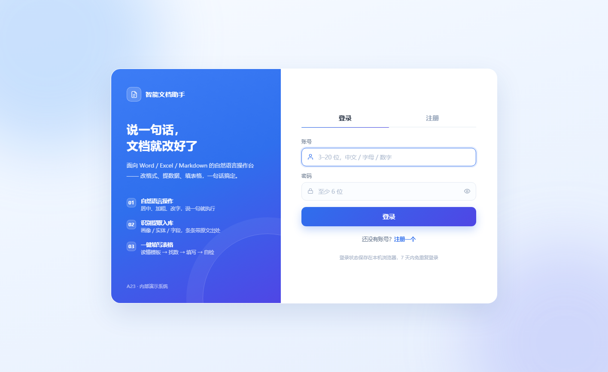
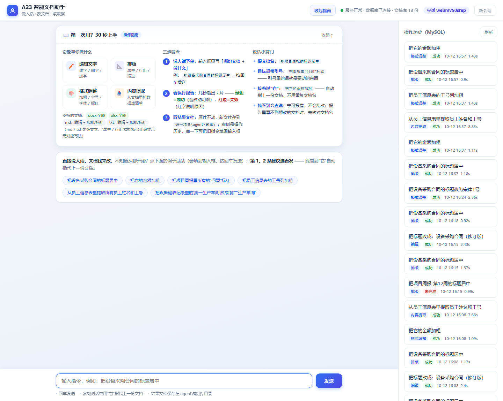
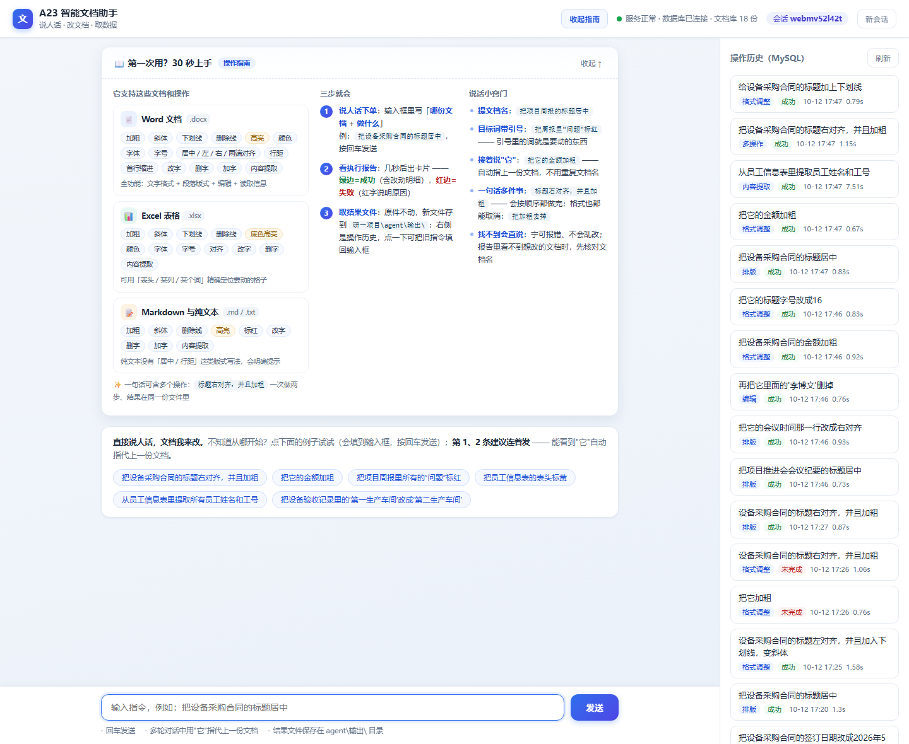
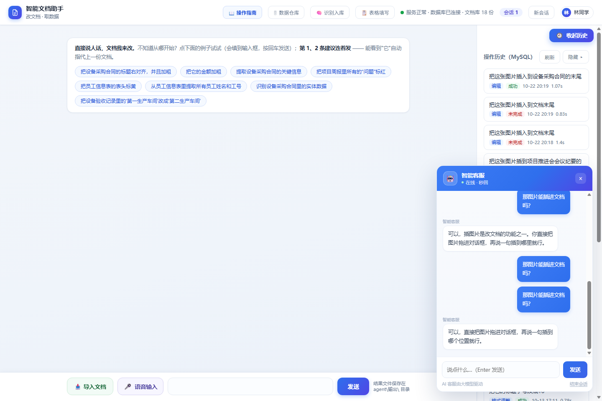
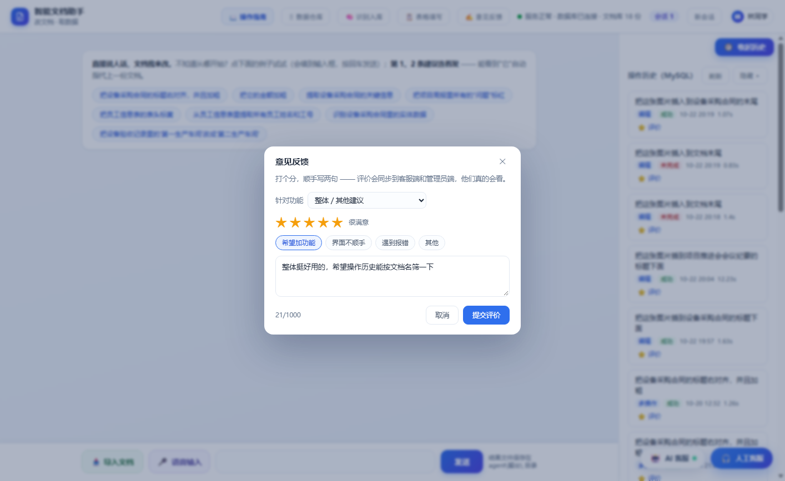
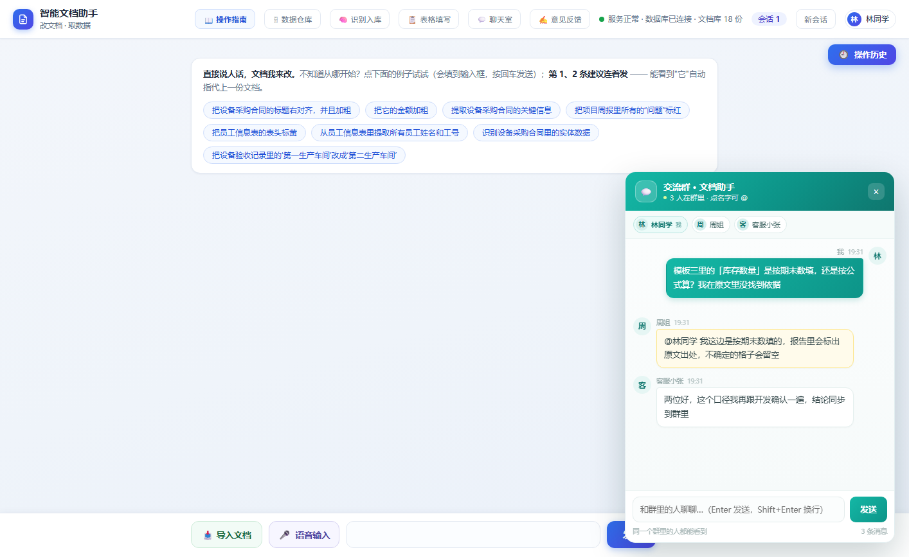

# A-23 智能文档助手

把散落的非结构化文档读进来，抽出结构化字段存进数据库，再按模板表自动填好，**每条数据都能指回原文**。

研一阶段对赛题「基于大语言模型的文档理解与多源数据融合系统」的复现与工程化实现，含可运行的本地 Web 操作台。

> 下文所有指标均为本机实测，不是官方评测结果。

## 三个模块

| 模块 | 做什么 | 主要代码 |
|---|---|---|
| ① 文档智能操作 | 读 docx / xlsx / md / txt，按自然语言指令改写内容、调整格式、提取指定片段 | `agent/parse_intent.py` → `edit.py` / `format_ops.py` / `extract_ops.py` |
| ② 信息提取与入库 | 抽实体、文档画像、字段，写入 MySQL 五张表，全部带原文位置 | `extract_ops.py` / `entity_ops.py` / `store.py` |
| ③ 表格填写 | 多份文档 + 模板表结构 → 定位到「列 × 行」，逐格填值 | `matcher/` + `writer/` + `pipeline.py` |

设计上的两条底线：

- **程序算、模型判**。数值计算、格式、行列定位交给确定性代码，模型只做「这堆证据对应哪个字段」这类判断。
- **宁可留空，不猜**。找不到依据的格子留空并在报告里标出，错填比不填更难发现。

## 界面

登录页（用户 / 客服 / 管理员三类角色）：



操作台：左侧文档库，右侧对话式指令，结果区给出改动前后对比与来源：





AI 客服与数字人「小橘」（纯内联 SVG，语音走 edge-tts + 本地缓存）：




七个功能点都能评价，反馈回流到客服端和管理端：



语音输入：浏览器识别不通时自动降级到本机离线识别，录音不出本机：


多人聊天室：用户在同一个群里交流用法、互相答疑，2.5 秒轮询增量取消息，
在线名单点一下就能 @ 人，自己的消息 5 分钟内可撤回：



## 目录结构

```
研一项目/
├── pipeline.py              总控：读文档 → 匹配 → 抽取 → 写表
├── doc_reader/              ① 文档读取器（按格式分流、切块）
├── template_reader/         ② 模板表读取器（表头 / 合并单元格 / 公式列）
├── matcher/                 ③ 检索与抽取（retrieve / extract / run_all）
├── writer/                  ④ 写入器（xlsx + word，保留原样式）
├── agent/                   操作台
│   ├── api_server.py        FastAPI 服务与全部接口
│   ├── web/                 index.html / admin.html / staff.html / login.html
│   ├── parse_intent.py      指令解析（阿里云百炼 · deepseek-v4.1-flash）
│   ├── llm_config.py        模型配置与调用入口（地址/模型/密钥只在这里配）
│   ├── edit.py format_ops.py extract_ops.py summary_ops.py entity_ops.py
│   ├── store.py pool.py db.py quality.py auth.py support.py feedback.py room.py
│   ├── asr.py               本机离线语音识别（faster-whisper）
│   ├── digital_tts.py       数字人语音合成（edge-tts + 缓存）
│   └── models/              语音模型（不进仓库，见「环境重建」）
├── 测试数据/                源文档 18 份 + 模板表格 5 张
├── 五表连测/                5 张模板连续跑测的结果与报告
├── 泛化测试/                3 个换了场景的泛化验证
├── 压测-大文档/             16 份 500KB 级文档的压力测试
├── 收尾对照/                验收脚本与对照记录（模块 1/2/3 + 作品要求）
├── 组会汇报-A23/            关于本项目的汇报材料
└── docs/screenshots/        README 用图
```

## 环境要求

- Python ≥ 3.10（本机在 3.13 上验证）
- MySQL 8（5.7 亦可）
- 开发环境为 Windows；Linux / macOS 未验证

## 快速开始

```bash
# 1. 安装依赖
pip install -r requirements.txt

# 2. 配置数据库连接
cp agent/db_config.example.json agent/db_config.json   # 然后填写用户名和口令

# 3. 建库建表（幂等，可反复执行）
python agent/db.py --init

# 4. 启动操作台
cd agent && python api_server.py        # 默认 http://127.0.0.1:8000
```

页面地址：`http://127.0.0.1:8000/login`，登录后按角色跳转到 `/`（用户端）、`/staff`（客服端）、`/admin`（管理端）。内置演示账号定义在 `agent/auth.py` 顶部，仅供本地演示。

可选参数：`--host` / `--port` / `--docs`（文档库目录，默认「源文档 + 导入文档」两个目录）。

## 配置

| 配置项 | 位置 | 说明 |
|---|---|---|
| 数据库连接 | `agent/db_config.json` | 该文件已加入 `.gitignore`，请从 `db_config.example.json` 复制 |
| 大模型 | `agent/llm_config.py`（或环境变量 `DASHSCOPE_API_KEY`） | 阿里云百炼 MaaS 的 OpenAI 兼容接口，默认模型 `deepseek-v4.1-flash`；全项目只在这一处配，改完可跑 `python agent/llm_config.py` 自检 |

## 环境重建

仓库里**故意不放**这两样东西，换机器时补跑两个脚本即可：

| 缺什么 | 体积 | 怎么补 |
|---|---|---|
| `agent/models/faster-whisper-small/` | 463 MB | `python agent/download_asr_model.py` |
| `agent/.wheels/`（离线安装包 26 个） | 88 MB | `python agent/install_asr_deps.py` |

`install_asr_deps.py` 是为「pip 直连不通」的环境准备的：先下载 wheel 到本地目录，再 `--no-index` 安装。`--check` 可只检查不安装。

## 实测指标

| 项目 | 结果 |
|---|---|
| 作品要求 | 17 / 17 |
| 模块 1 功能覆盖 | 8 / 8 |
| 模块 2 与标准答案对照 | 22 / 22 |
| 模块 3 与标准答案对照 | 26 / 26 |
| 填写准确率 | 16 份文档 → 5 张模板，每张表 ≥ 80%，每份文档 ≤ 90s |
| 入库数据 | 9 份文档 / 266 条记录（137 实体 + 4 画像 + 75 字段），100% 可溯源 |

验收脚本都在 `收尾对照/`，可单独重跑。

## 已知限制

- 只处理 docx / xlsx / md / txt；扫描版 PDF 与图片未做 OCR。
- 表头语义靠模型判断，跨块定位偶有失败，失败时留空并记录，不会硬填。
- 客服会话用 1.6 秒轮询而非 WebSocket，多客服同时在线时消息延迟略高。
- 聊天室是一个公共大群（2.5 秒轮询），没有分群 / 私聊 / 图片，单条上限 500 字、同一人 1 秒一条。
- 语音识别降级到本机模型后，单句约 2 秒，比浏览器原生识别慢。
