# A-23 智能文档助手

把散落的非结构化文档读进来，抽出结构化知识存进数据库，再按模板表自动填好，**每条数据都能指回原文**。
扫描件、照片、繁体竖排的老文件也能读；一句话就能改文档，常用操作不用等模型。

研一阶段对赛题「基于大语言模型的文档理解与多源数据融合系统」的复现与工程化实现，含可运行的本地 Web 操作台。

> 下文所有指标均为本机实测，不是官方评测结果。

## 三个模块

| 模块 | 做什么 | 主要代码 |
|---|---|---|
| ① 文档智能操作 | 读 docx / xlsx / md / txt / PDF / 图片（扫描件走 OCR，简繁英与竖排都认），按自然语言指令改写内容、调整格式、提取指定片段；13 个常用指令可一键执行 | `agent/parse_intent.py` → `edit.py` / `format_ops.py` / `extract_ops.py`；`agent/ocr.py` |
| ② 知识抽取与入库 | 先零模型扫出文档骨架，再由模型归纳这份文档自己的结构，逐值抽取并回原文核验，写入 MySQL；实体 / 画像 / 字段三条旧线已并入 | `agent/knowledge.py` / `store.py` / `summary_ops.py` |
| ③ 表格填写 | 多份文档 + 模板表结构 → 定位到「列 × 行」，逐格填值；规整大表走确定性直通，不占模型 | `matcher/`（`direct.py` / `rowscope.py` / `anchor.py`）+ `writer/` + `pipeline.py` |

设计上的三条底线：

- **程序算、模型判**。数值计算、格式、行列定位交给确定性代码，模型只做「这堆证据对应哪个字段」这类判断。
- **宁可留空，不猜**。找不到依据的格子留空并在报告里标出，错填比不填更难发现。
- **能不走模型就不走**。命中直通或预设指令时直接算，秒级出结果，也不受模型额度影响。

## 最近扩展（2026-11 更新）

以下都是赛题之外自己加的，方向是「少让人学工具、多让系统理解意图」。

### 智能操作：一句话 → 立即执行

左栏「🤖 智能操作」里有 13 个常用指令（对齐 / 加粗 / 字号 / 行距 / 缩进 / 替换 / 高亮 / 字体 / 字色 …）。
点一下就发一个 `preset`，**跳过模型解析，0.05~0.8 秒出结果**（原来走一遍大模型要 5~30 秒）。
输入框里直接打字仍然走完整的自然语言解析，两条路并存：

| 入口 | 走什么 | 耗时 |
|---|---|---|
| 点快捷指令 | 固定预设，程序直接执行 | 0.05~0.8s |
| 输入一句话 | 模型解析意图 → 执行 | 5~30s |
| 指令里点了别的文档 | 只改点名的文档，不覆盖 | — |

同一项再点一次等于取消（开关式），不支持的项按文档类型自动灰化。

### 识别入库：文档 → 知识，上传的也算

勾文档 → 自动读懂 → 抽取 → 入库。实现上三件事值得说：

- **结构从文档本身归纳**，不用预置模板。骨架扫描不调模型，只调一次模型归纳「这份文档有哪些属性」，
  属性名必须在骨架里出现过，防止模型编。
- **表格直读**（不调模型）+ 叙述体按批抽取，**每个值逐字回原文核验**，核不上的不写库。
- **用户自己上传的文档也能识别**。解析池只扫「源文档」目录，上传件落在「导入文档」，
  所以加了「池里没有 → 现场读」的兜底（缓存到 `agent/.cache/docs/`），不用手动 rebuild。

明细表（2000 行站点数据、2 万行监测数据）不会按行折叠成几百个错乱对象：识别到流水号列
或高重复列时，对象名改成「名称｜时间」。实测 2 万行表：1989 对象 / 33920 条 / 66~72s。

### 知识图谱：不只是一张关系图

`knowledge_graph()` 一次算五类边：字面关系、自属性、同值共享（含跨属性同值）、同类中枢、同文档中枢。
`collapse=1` 会把「A-属性→值←属性-B」折成一条 `A-[属性=值]->B`，避免图上全是中间值节点。
前端 6 个视角、3 种布局、图例可关，点节点出关系清单。>8 个对象的大团不折叠（折了会看不清）。

### 文字识别：简体 · 繁体 · 英文 · 竖排

原来的引擎自带的是**简体字库**，「驗收單」会认成「收軍」、「監測」认成「盤測」——不是模糊，是缺字。
现在按语言换模型：

| 语言 | 模型 | 说明 |
|---|---|---|
| 自动 / 简体 / 繁体 | PP-OCRv5 中文 | 一套字表同时认简繁英，简体样本不掉分 |
| 英文 | PP-OCRv5 英文 | 纯英文文档专用，编号 / 金额 / 日期更准 |

**竖排只重排、不重认**——字本身是正立的，旋转 90° 反而认不出。做法是同列多框按 bbox 并集拼整、
整行按汉文习惯**从右到左**排序；字距大的单字方框有竖向堆叠兜底。开关可关（关掉即按原顺序）。

验收：接口自检 30/30（含简繁不互伤、竖排列序、印刷回归），手写回归 16/16 零退化。
模型不进仓库，`python agent/下载OCR模型.py` 从 modelscope 拉（约 24 MB），缺失时自动回落旧模型、不报错。

### 表格填写：直通优先，行条件真读得懂

- **直通默认开启**：源表规整、列名对得上时，逐块筛行、整列搬数，不喂给模型。真实三表数据 **616/616**，
  84.2s → 11s（模型装不下几千行，数量级本身就是判据）。
- **行条件**：支持「表一：日期 2025-01-01~2025-03-31」「站点=E1001」这类写法，日期与时间分开解析
  （合写会把 `10:00` 匹配成空，25 行变 370 行）。分段 > 全局 > 表前描述，优先级明确。
- **多块模板**：一份 docx 里好几张同构表，各自筛行、填写、验收，不再只写第一张。
- **选源文档**：填表时勾哪几份，就只在这几份里找数（不勾 = 全库），避免别的文档串味。

## 界面

欢迎页：系统简介 + 操作指南，每条都能点，点了直接打开对应功能：

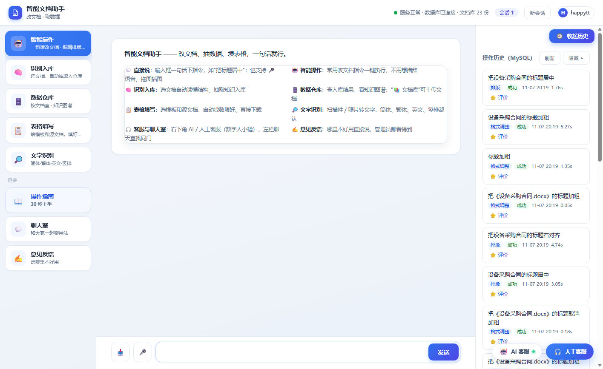

登录页（用户 / 客服 / 管理员三类角色）：

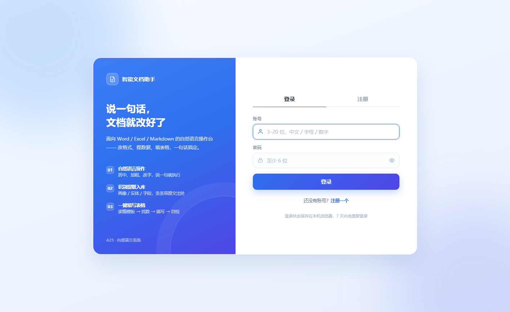

操作台：左侧文档库，右侧对话式指令，结果区给出改动前后对比与来源：

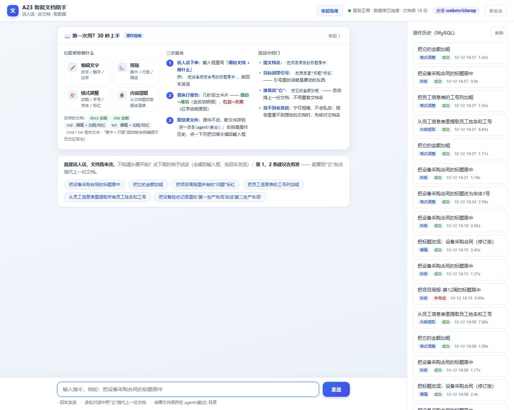

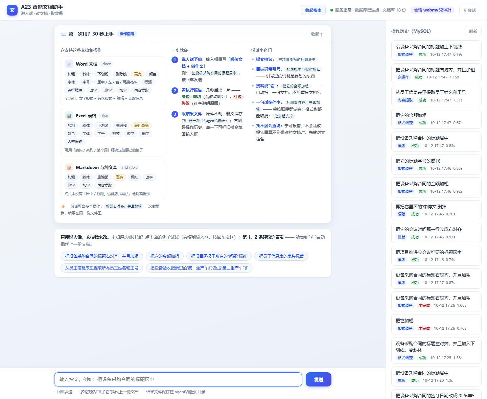

AI 客服与数字人「小橘」（纯内联 SVG，语音走 edge-tts + 本地缓存）：

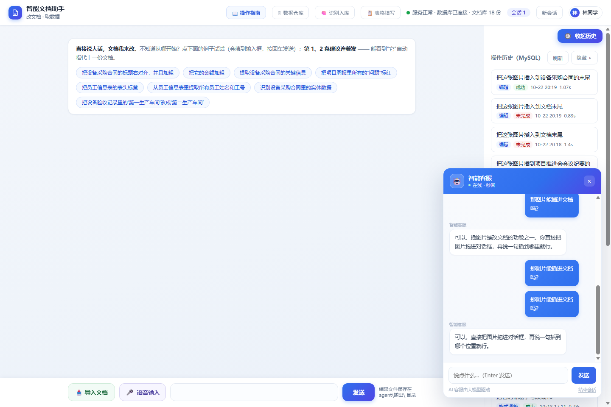


七个功能点都能评价，反馈回流到客服端和管理端：

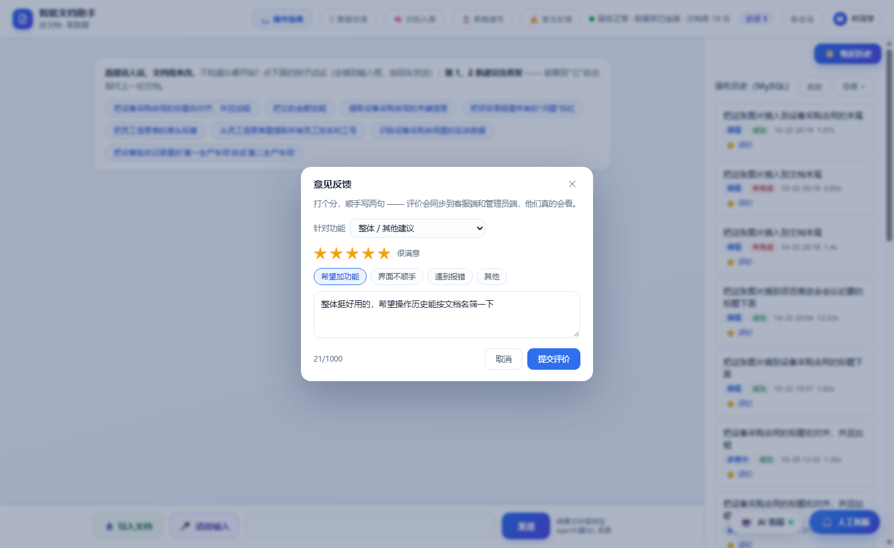

语音输入：浏览器识别不通时自动降级到本机离线识别，录音不出本机：


多人聊天室：用户在同一个群里交流用法、互相答疑，2.5 秒轮询增量取消息，
在线名单点一下就能 @ 人，自己的消息 5 分钟内可撤回：

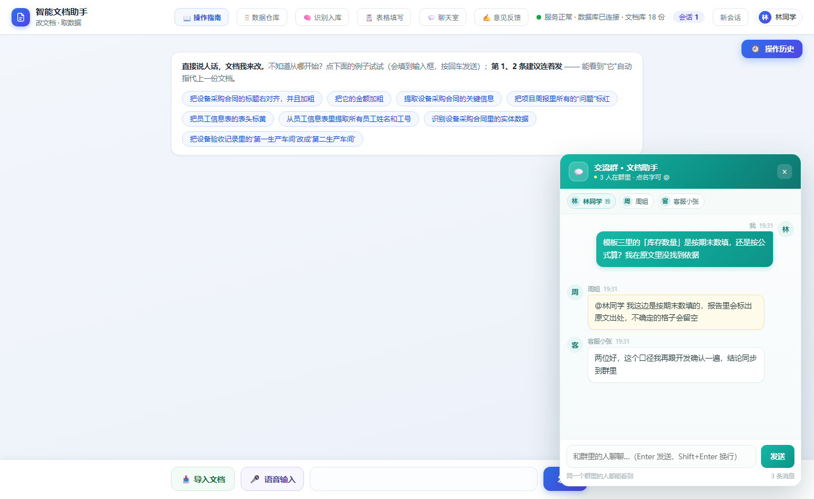

表格填写支持上传自己的模板（.xlsx / .xlsm / .docx）——上传后立刻出现在下拉框里并自动选中，
也可以直接把文件拖进窗口。自己传的模板带「我上传的」标记、可以删除：

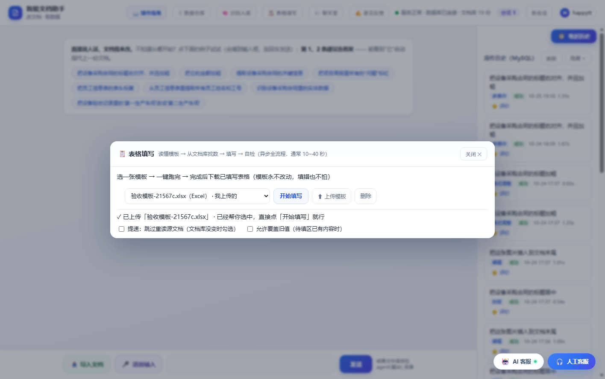

面板右上角「🗂 我上传的模板」是一张清单：自己传过哪些、多大、什么时候传的，都在这里，
一条一个「删除」，删完下拉框立刻同步。系统自带的 5 张 Excel / 5 张 Word 不在清单里，也删不掉：

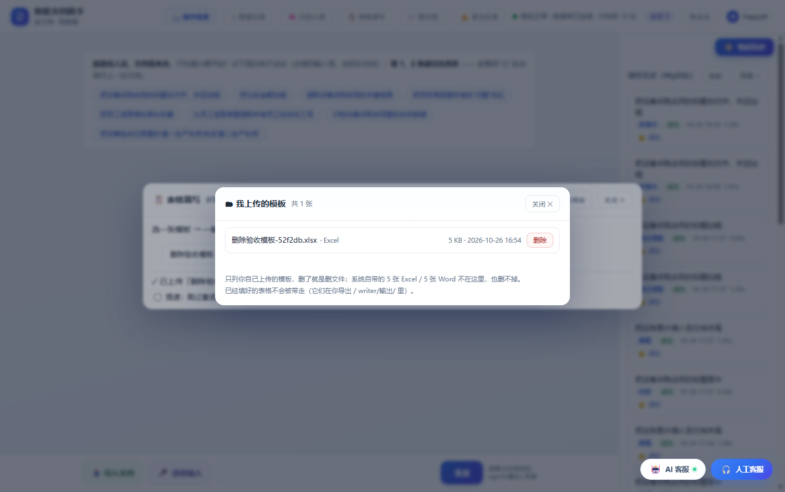

模板**不是规整表也能填**。多层表头（父列合并跨若干子列）会读成「父-子」合成列名，
子列名在本表内唯一时保持简洁（`供应商名称` 不会变成 `供应商信息-供应商名称`）；
斜线表头的一个格子里塞两个维度，会拆出主名和别名，不再整串当一个列名：

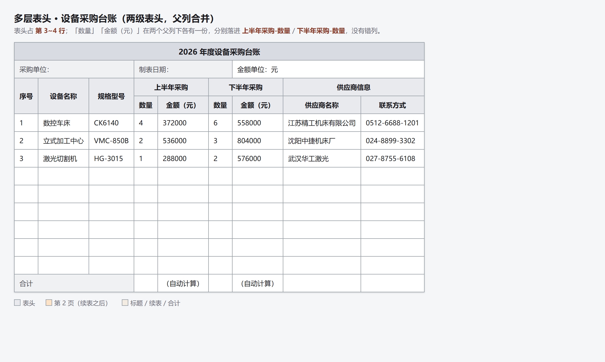

跨页表（第二页重复表头、中间夹「续表」）会把两段拼成一张表连着填，
第 10 条记录接着落在第 2 页第 1 行，不会漏掉半页、也不会把「续表」那行冲掉：

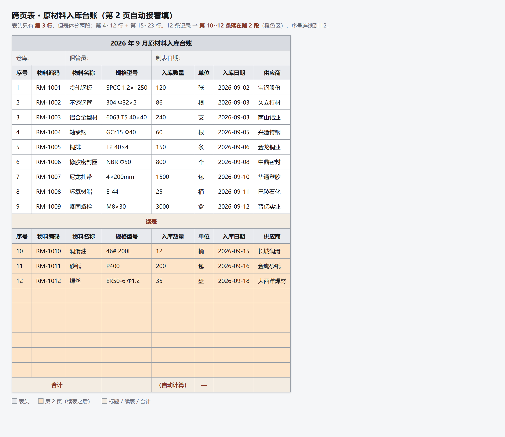

扫描版 PDF 和照片、截图也能用：顶栏「🔎 文字识别」上传后立刻出全文，每段都标了来源
（第几页 / 文字层还是 OCR / 置信度），确认没问题再一键「并入文档库」——
之后就能对它下指令、跑识别入库、当填表的数据源：

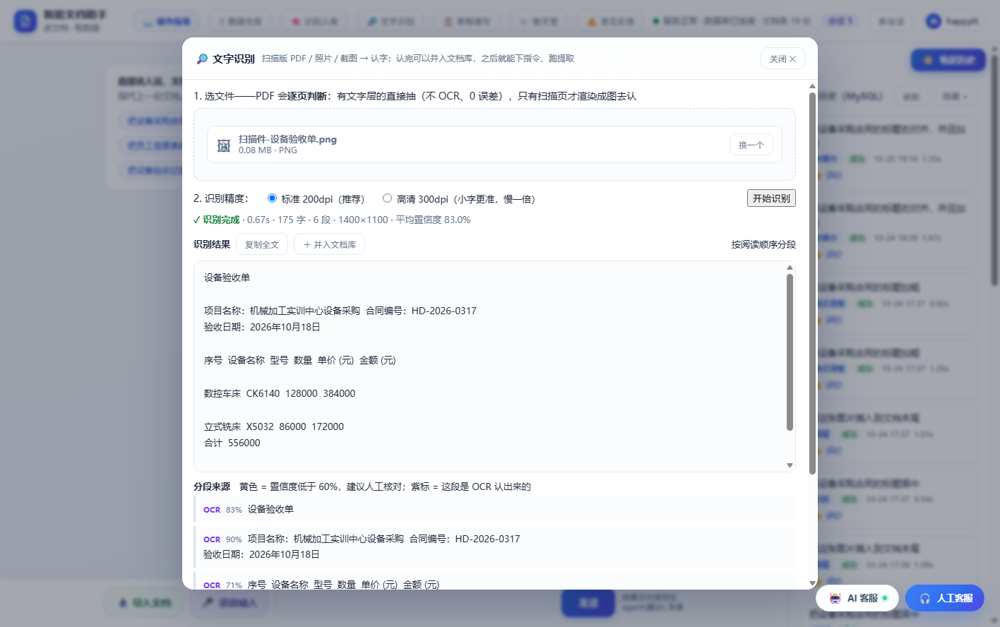

PDF 是**逐页**判断的：自带文字层的页直接抽（0 误差、毫秒级），只有扫描页才渲染成图去认。
所以「电子版正文 + 扫描签字页」这种混着来的 PDF 也能处理：

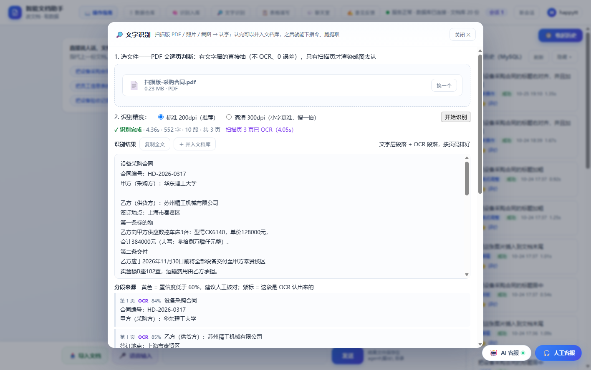

## 目录结构

```
研一项目/
├── pipeline.py              总控：读文档 → 匹配 → 抽取 → 写表
├── doc_reader/              ① 文档读取器（按格式分流、切块；pdf/image 阅读器内接 OCR）
├── template_reader/         ② 模板表读取器（表头 / 合并单元格 / 公式列）
├── matcher/                 ③ 检索与抽取
│   ├── retrieve.py extract.py run_all.py
│   ├── direct.py            规整大表直通（筛行 + 整列搬，不调用模型）
│   ├── rowscope.py          行条件解析（日期区间 / 等值条件 / 分段）
│   └── anchor.py            定源打分（这份列的来源是哪份文档）
├── writer/                  ④ 写入器（xlsx + word，保留原样式）
├── agent/                   操作台
│   ├── api_server.py        FastAPI 服务与全部接口
│   ├── web/                 index.html / admin.html / staff.html / login.html
│   ├── parse_intent.py      指令解析（走 llm_config 的模型线路）
│   ├── llm_config.py        模型配置与调用入口（多家平台、额度用尽自动换下一家）
│   ├── edit.py format_ops.py extract_ops.py summary_ops.py entity_ops.py
│   ├── knowledge.py         知识抽取：骨架 → 归纳结构 → 逐值回原文核验 → 入库
│   ├── ocr.py               文字识别（PP-OCRv5 多语言 / 手写增强 / 竖排重排）
│   ├── semantic.py          字段语义匹配（bge-small-zh 本地向量）
│   ├── store.py pool.py db.py quality.py auth.py support.py feedback.py room.py
│   ├── asr.py               本机离线语音识别（faster-whisper）
│   ├── digital_tts.py       数字人语音合成（edge-tts + 缓存）
│   ├── 下载OCR模型.py        拉 PP-OCRv5 中/英识别模型到 models/ocr/
│   └── models/              语音 / OCR 模型（不进仓库，见「环境重建」）
├── 测试数据/                源文档 18 份 + 模板表格 5 张 + OCR 多语种样本
├── 五表连测/                5 张模板连续跑测的结果与报告
├── 泛化测试/                3 个换了场景的泛化验证
├── 压测-大文档/             16 份 500KB 级文档的压力测试
├── 收尾对照/                验收脚本与对照记录（模块 1/2/3 + OCR + 作品要求）
├── 组会汇报-A23/            关于本项目的汇报材料
└── docs/screenshots/        README 用图
```

## 环境要求

- Python ≥ 3.10（本机在 3.13 上验证）
- MySQL 8（5.7 亦可）
- 开发环境为 Windows；Linux / macOS 未验证

## 快速开始

```bash
# 1. 安装依赖
pip install -r requirements.txt

# 2. 配置数据库连接
cp agent/db_config.example.json agent/db_config.json   # 然后填写用户名和口令

# 3. 建库建表（幂等，可反复执行）
python agent/db.py --init

# 4. 生成文档解析池（仓库里不带这个大文件，换机器第一次要跑一遍；之后按需重建）
python agent/pool.py --rebuild

# 5. 启动操作台
cd agent && python api_server.py        # 默认 http://127.0.0.1:8000
```

页面地址：`http://127.0.0.1:8000/login`，登录后按角色跳转到 `/`（用户端）、`/staff`（客服端）、`/admin`（管理端）。内置演示账号定义在 `agent/auth.py` 顶部，仅供本地演示。

可选参数：`--host` / `--port` / `--docs`（文档库目录，默认「源文档 + 导入文档」两个目录）。

## 同门协作 / 换台机器上线

**加入仓库**：仓库页面右上 **Settings → Collaborators → Add people**，填对方 GitHub 用户名，对方在邮件里点接受后即可 push。

**clone 下来还不能直接跑**，仓库里故意没放这四样，各自补一次：

| 缺什么 | 为什么要自己补 | 怎么补 |
|---|---|---|
| Python 依赖 | 依赖装在每个人自己的电脑上 | `pip install -r requirements.txt` |
| MySQL 与连接配置 | 数据库不随代码走 | 装 MySQL 8 → 复制 `agent/db_config.example.json` 为 `agent/db_config.json` 填账号口令 → `python agent/db.py --init`（会自动建 `a23_agent` 库和全部表，幂等） |
| 大模型密钥 | **密钥不共享**，各人有各自的额度 | 去智谱 [申请 key](https://open.bigmodel.cn/usercenter/apikeys)（新用户赠 1500 万 token，够跑很久），写进 `agent/llm_key.txt` 一行 `zhipu=你的key`（已 gitignore）。**一家不够就多写几行**，用完了会自动换下一家，详见下面「模型线路」 |
| 离线语音模型（可选） | 463 MB，太大不适合进仓库 | `python agent/download_asr_model.py`。只影响语音输入，其他功能不受影响 |
| OCR 引擎（可选） | `pymupdf` + `rapidocr_onnxruntime` 约 120 MB，已列进 `requirements.txt` | 装不上也不致命：装了 `pymupdf` 就能读电子版 PDF；两个都没装时 PDF / 图片导入会提示原因。Windows 上还可以退到系统自带 OCR（设置 → 时间和语言 → 语言 → 加「简体中文」） |

补齐后双击 `启动操作台.bat` 即可（脚本会用 PATH 里的 python；没有 Python 会明确提示去装）。

**日常协作**：开工先 `git pull`，改完 `git add -A && git commit -m "改了什么" && git push`。两人尽量改不同文件，冲突会少很多。

## 配置

| 配置项 | 位置 | 说明 |
|---|---|---|
| 数据库连接 | `agent/db_config.json` | 该文件已加入 `.gitignore`，请从 `db_config.example.json` 复制 |
| 大模型 | `agent/llm_config.py` + `agent/llm_key.txt` + 环境变量 `A23_PROVIDER` | 支持多家平台按顺序自动切换，**第一家额度用完会自己跳到下一家**，不再整个系统停摆。配完跑 `python agent/llm_config.py --test` 看哪家能用。详见下一节 |

## 模型线路：一家不够就用一串

### 为什么改成这样

免费额度是会用完的。2026-11-02 百炼的免费额度耗尽，报 `403 Free quota exhausted`，
而当时地址和模型名是写死的，只能改代码才能换 —— 整个抽取链路直接停摆，
连"重跑一遍验证改动"都做不了。

现在 `llm_config.py` 里是**一串平台**，按顺序试，第一家不行自动跳第二家。

### 内置的四家

| 平台 | 模型 | 免费情况 | 说明 |
|---|---|---|---|
| `zhipu` 智谱 | `glm-5.3-flash` | 新用户赠 **1500 万 token** | 首选。国内直连（实测 1.5~2.4s 一次），**始终思考**、用 `reasoning_effort=low` 降档（2.1s / 46 token，不传是 3.4s / 92 token）；单并发，高峰会 429 |
| `siliconflow` 硅基流动 | `Qwen/Qwen3-8B-Instruct` | 注册送额度 + 部分模型永久免费 | 备用。模型名可在控制台换成别的 |
| `dashscope` 百炼 | `deepseek-v4.1-flash` | 额度已用尽，可当付费兜底 | 原主力，质量最好 |
| `ollama` 本机 | `qwen2.5:7b-instruct` | **完全免费、无限量、断网也能用** | 要自己装 Ollama。准确率不如云端，适合跑批量回归 |

### 怎么配

`agent/llm_key.txt`（已 gitignore）一行一家：

```
zhipu=你的key
siliconflow=sk-你的key
```

只有一行、不写平台名的老格式会当成百炼的 key —— 旧文件不用改。

也可以用环境变量（优先级更高）：`ZHIPU_API_KEY` / `SILICONFLOW_API_KEY` / `DASHSCOPE_API_KEY`。
指定首选：`set A23_PROVIDER=zhipu`。

### 自动切换只在该换的时候换

| 情况 | 行为 | 为什么 |
|---|---|---|
| 429 限流 | **先在同一家等 2/6/15 秒重试**，三次都不行才换下一家 | 429 是"先歇会儿"，不是"这家废了"。直接换家会把唯一能用的一家误判成不可用，而别家可能还欠费 |
| 401 key 错 / 402 没余额 / 403 没权限 / 404 模型名错 | **换下一家** | 换一家能救回来 |
| 400 参数错 / 连接超时 | **不换**，直接报错 | 换家也一样错，白打一次请求还让错误信息变模糊 |
| 换过的家 | 进冷却（401/404 冷却 30 分钟，402/403 10 分钟，429 30 秒） | 避免每次调用都先撞一次墙 |
| 全部在冷却 | 忽略冷却全试一遍 | 否则系统看起来彻底不可用 |

另外：**本机模型强制不走系统代理**。这项目以前踩过——开着系统代理时连 `127.0.0.1`
会被劫持，POST 看似通、GET 回假 404。

### 换模型时要注意的三件事（2026-11-02 实测踩到）

**一、"始终思考"的模型不能传 `thinking:{type:disabled}`，会直接 400。**

`glm-5.3-flash` 就是这类。它只认 `reasoning_effort`（low / high / max）：

| 传什么 | 结果 |
|---|---|
| `thinking: {"type": "disabled"}` | ✘ 400 `该模型始终思考，不支持关闭思考` |
| `thinking: {"type": "low"}` | ✘ 400（同上，格式不对） |
| `reasoning_effort: "low"` | ✔ 2.1s / 46 token ← **用这个** |
| 什么都不传 | ✔ 3.4s / 92 token（默认思考量更大） |

`llm_config.py` 里 `PROVIDERS["zhipu"]["thinking"]` 就是配这个的。
注意 `glm-4.7-flash` 反过来：它认 `("thinking", {"type": "disabled"})`，
**不认 `reasoning_effort`** —— 换回老模型时要一起改这一行。

**二、`response_format=json_object` 可能多包一层外壳：**

```
本来要：  {"items": [...]}
可能返回：{"answer": {"items": [...]}}
```

解析若不剥壳，就是"JSON 解析成功、但 0 条结果"——看起来像模型什么都没抽到，
极难排查。`matcher/extract.py` 的 `_unwrap_items()` 会剥 `answer`/`result`/`data`/
`output` 这几种壳。（实测：prompt 里把输出格式写清楚，`glm-5.3-flash` 就不加壳了。）

**三、模型名别照控制台抄。** 控制台显示的 `glm-4.7-flashX` 和文档里的
`glm-4.7-flash` 实测都能调通（6.0s / 2.5s）。模型名会随版本变，拿不准就跑
`python agent/探测模型.py`，它逐个试并告诉你能用哪些、认不认思考档位/JSON 参数。

### 自检与观测

```
python agent/llm_config.py --list    # 有哪几家、哪家配了 key
python agent/llm_config.py --test    # 逐家真发一条，看谁通
```

`GET /api/llm/status` 返回当前首选、尝试顺序、每家是否就绪 / 是否在冷却。

**不需要真 key 也能验这套逻辑**：`python 收尾对照/评测/模型切换-验收.py`
起两个假服务（一个专回 403，一个正常），验证 8 项，全过。


## 字段匹配：从「别名表」到「语义」

### 改之前的问题

模板写「合同总金额」，用户说「合同总价」；源文档表头写「总价（元）」。
旧实现靠两张**手工表**在撑：`agent/字段别名表.json`（口语→正式）和
`matcher/retrieve.py` 的两字片段打分为主的召回。两者都只认字面重合，
所以「总价」对不上「合同总金额」，只能人工补一条映射；换个行业
（医疗/物流/教育）字段名全换，别名表要从头配一遍。

### 改之后

字段名当一句很短的话，用**本地中文向量模型**算语义相似度
（`agent/semantic.py`，bge-small-zh-v1.5 的 ONNX 版，91 MB，512 维，
CPU 上约 1200 条/秒）。三路信号按可信度融合：

| 路径 | 分数 | 什么时候用 |
|---|---|---|
| 别名表 | 1.00 | 人工确认过的映射，永远最高优先（退成兜底/覆盖） |
| 字面 | 0.78~1.00 | 完全相等 / 互相包含 / 去单位后相等，不调模型也不该错 |
| 语义向量 | 0~1 | 主力：同一意思不同说法走这一路 |

候选清单不是人工写的，而是**从数据里长出来的**（文档表格列头 +
「XX：」标签），所以换行业不用配任何东西：新行业的数据进来，
候选空间自动变成那个行业的词。`FieldSpace` 还能把一批说法自动聚成
同义簇（合同金额 / 合同总价 / 总价（元）抱成一团）。

候选池干不干净直接决定匹配准不准，所以表头行是算出来的、不是"取前 5 个"：
按每张表分别算（一份文档可能好几张表，表头行不在同一行），只取表头行及其
上方的文本，数据值、「第三条 …」这类条款标题、文档大标题、编码型文本都滤掉。

### 两个克制的地方（都是实测调出来的）

1. **改写要严**：把用户说的词直接换成文档里的词，门槛是「相似度 ≥ 0.85
   且领先第 2 名 ≥ 0.15」。因为改错了会去抽另一列，比不改更糟 ——
   「库存数量」对「期初库存」0.75 / 「期末库存」0.72，这种"两个都像"的
   只放进候选，等直抽为空时再逐个试，由模型按原文判。
2. **字面能对上时语义不介入**：全池字面最高分 ≥ 40（说明这个说法原文里
   就有）就完全不启用语义，避免语义块抢候选名额把原有顺序搅乱。
   10 张模板 70 列的回归因此是零变化。

### 实测（`python 收尾对照/语义匹配-验收-1026.py` 可重跑）

| 项目 | 结果 |
|---|---|
| 同义说法自检（10 组） | Top1 10/10，Top3 10/10 |
| 反例（源里真没有的字段） | 3/3 留空，没有硬认 |
| 真实文档召回（18 个口语说法） | 字面 0/18 → 语义 16/18 |
| 10 张模板回归（70 列） | 一致 70，退化 0 |
| 跨行业零配置（5 行业 59 组） | 字面 Top3 37% → 语义 Top3 100%；人工映射从 37 条降到 0 条 |
| 端到端字段归一（4 份文档） | 6 个改写得当，8 个保守保留原词 |
| 候选池干净度（4 份文档） | 13/12/10/12 个候选，数据值/条款标题/大标题 0 混入 |

### 模型缺失会自动降级

`models/` 不进仓库（91 MB）。没下载模型时，`semantic.py` 自动退回
「别名表 + 字面」，功能不消失、不报错，只是少了语义那一路
（接口 `GET /api/semantic/status` 会如实返回 `available: false` 及原因）。

补模型：

```bash
python agent/下载语义模型.py          # 从 hf-mirror 拉，约 91 MB，支持断点续传
```

### 接口

| 接口 | 作用 |
|---|---|
| `GET /api/semantic/status` | 模型装没装、多大、多少维、阈值 |
| `POST /api/semantic/match` | `{query, candidates?/doc?, topk}` → Top-K + 每一名的分数与依据（`alias`/`exact`/`lexical`/`semantic`） |
| `GET /api/llm/status` | 当前用哪家模型、尝试顺序、每家是否就绪 / 在冷却 |

填表流水线的报告里也会多出「列名 → 源文档里的说法」的对照行，
说明这一列是靠语义找回来的，不是靠别名表。

## 历史填写参照：同一张表第二次填，直接用上次的映射

组会 PPT 第 11 页列的第三件事：「把库里历史填写的记录用起来，填新表前先查同类表是怎么填的」。

关键是想清楚**复用的是什么**。不是复用值 —— 数据每期都变，抄值必错。
能复用、而且复用了一定更准的，是**映射关系**：

```
模板里的这一列  ←来源←  某份文档里某个列头 / 标签
    库存数量      ←          期末库存
    数量          ←          数量（台）
    供应商        ←          乙方（供货方）        ← 表外段落
```

这三条都是"填对过一次"才留下来的，比字面猜和语义猜都可靠。下次同一张表（哪怕换了
一批数据文档）直接拿「期末库存」当锚点去抽，不用再在「期初库存 / 期末库存 / 存放库位」
里猜一遍。

### 三级复用（越靠上越省事）

| 级别 | 判据 | 怎么做 |
|---|---|---|
| ① 同一张模板 | 列名指纹（md5）完全一致 | 每列的历史映射全部可用 |
| ② 改版过的模板 | 列名重合 ≥ 70% 且至少 2 列 | 只复用列名完全相同的那些列 |
| ③ 没填过 | — | 返回空，退化成「定源 + 语义」，什么都不会更差 |

### 两个实测出来的护栏

- **只锚"整列"，不锚"一格"**：历史列头在候选里找到 ≥2 块，才把候选**收缩**成这一列；
  只有 1 块时只排到最前、不收缩。收缩是关键 —— 历史已经确定列在哪，再把干扰列摆给
  模型看，只会让它重新纠结一遍（实测叠加式把 33.4s / 13065 token 拖到 36.2s / 17055 token）。
- **同一个格子不能对应两条记录**：一列里"个"出现 3 次、"台"出现 2 次时，按值反查格子
  永远命中第一个，另外两格就空着。改成"同值各用一次"（`extract._assign_by_value`）。
  这一条对所有列都生效，没冲突时一条不改。

另外修了数字定位的一个隐性错位：`95` 会被当成 `1950` 的子串，导致整列错位一格
（模板5 实测 100% → 97.6%）。纯数字的格子现在要求"独立出现"（前后不是数字或小数点）。

### 实测

| 项目 | 结果 |
|---|---|
| 同一张模板第二次填（模板5「库存数量」单列） | 34.4s / 3035 token → **4.6s / 1505 token**，10 条照样全对 |
| 五表两轮（第 1 轮建历史 → 第 2 轮命中） | 都 100%，5/5 达标，验收全通过 |
| 历史映射质量 | 5 张模板 30 列，锚点全部是真实列头（"数量←数量（台）"这类换说法也认） |

两轮对照报告：`收尾对照/评测/历史参照-第1遍-无历史.txt`、`历史参照-第2遍-命中历史.txt`。

### 存在哪

| 位置 | 作用 |
|---|---|
| `matcher/历史填写.json` | 主存档（本地，MySQL 挂了也不影响填表） |
| MySQL `a23_agent` 的 `fill_templates` / `fill_columns` | 镜像，可 SQL 按模板 / 列名查 |
| `GET /api/fill/history` | 最近 20 次填写摘要 |
| `GET /api/fill/history?template=模板5-原材料库存汇总表.xlsx` | 这张表的列映射（操作台可展示"上次怎么填的"） |

```bash
python matcher/history.py            # 看历史
python matcher/history.py --clear    # 清空（MySQL 镜像不动）
python matcher/run_all.py --no-history   # 本次不用历史（A/B 对比）
python matcher/run_all.py --no-save      # 本次不写历史
```

## 环境重建

仓库里**故意不放**这两样东西，换机器时补跑两个脚本即可：

| 缺什么 | 体积 | 怎么补 |
|---|---|---|
| `doc_reader/output.json`（文档解析池） | 随数据增长，可达上百 MB | `python agent/pool.py --rebuild`（扫「源文档 + 导入文档」，本地生成） |
| `models/bge-small-zh-v1.5/`（字段语义匹配） | 91 MB | `python agent/下载语义模型.py` |
| `agent/models/ocr/`（OCR 简繁英识别模型） | 24 MB | `python agent/下载OCR模型.py`（从 modelscope 拉，已带断点续下） |
| `agent/models/faster-whisper-small/` | 463 MB | `python agent/download_asr_model.py` |
| `agent/.wheels/`（离线安装包 26 个） | 88 MB | `python agent/install_asr_deps.py` |

三样模型都是**缺了也能跑**：语义退回别名 + 字面、OCR 退回引擎自带的简体模型、语音输入不可用，其余功能不受影响。

`install_asr_deps.py` 是为「pip 直连不通」的环境准备的：先下载 wheel 到本地目录，再 `--no-index` 安装。`--check` 可只检查不安装。

## 实测指标

| 项目 | 结果 |
|---|---|
| 作品要求 | 17 / 17 |
| 模块 1 功能覆盖 | 8 / 8 |
| 模块 2 与标准答案对照 | 22 / 22 |
| 模块 3 与标准答案对照 | 26 / 26 |
| 填写准确率（16 份文档 → 5 张模板） | **5/5 表 100%**（口径见 `收尾对照/评测/口径规范.md`），每份文档最慢 51s ≤ 90s |
| 真实三表数据（新数据，非标准答案） | **616/616 格**对得上；直通 11s（旧链路 84.2s） |
| 2 万行明细表识别入库 | 1989 对象 / 33920 条 / **66~72s**（红线 90s） |
| OCR 多语种（繁 / 英 / 竖排） | 接口自检 **30/30**；手写回归 **16/16** 零退化；印刷件置信度 0.82 |
| 入库数据 | 9 份文档 / 266 条记录，100% 可溯源 |

验收脚本都在 `收尾对照/`，可单独重跑。

## 已知限制

- OCR 主认**印刷体**，**工整手写**与**繁体 / 英文 / 竖排**都已支持（手写：双阈值合并 + 按需放宽，
  验收 16/16；竖排：只重排不重认、从右到左，验收见 `收尾对照/OCR-多语种-接口自检-1107.py`）。
  仍认不出的：**连笔草书、手写签名、印章**——这几类要专门的手写/签名模型，不在当前范围。
  表格里的窄列（单个数字）仍容易漏检。
  扫描件质量差（歪斜超过 5°、分辨率低于 150dpi）时命中率明显下降，结果区会把低置信度的段标黄提示复核。
- 兜底引擎（Windows 自带 OCR）有约 300 万像素上限，超过会静默认不出字，
  所以引擎是它的时候自动按 160dpi 渲染；想用高精度请装 `rapidocr_onnxruntime`。
  它也不支持繁体与竖排，缺 v5 模型时会自动退回简体字库。
- 知识抽取：**同一份文档两次跑，"对象怎么划分"可能略有不同**（值不丢，只是聚合粒度会飘），
  所以演示别背固定数字，看报告里的「◆ 值可核」。版面式表格（整页当图排的）会跳过，不硬抽。
- 表头语义靠模型判断，跨块定位偶有失败，失败时留空并记录，不会硬填。
- 复杂表头的边界：多层表头按「连续几行都像表头」来认，父子层之间如果插了空行会被当成两段；
  斜线格只按换行或单个斜线拆，一个格子里塞三个维度的拆不出来；
  跨页表靠「续表」字样或表头原样重复来衔接，第二页表头被改写过（列名不同）就认不出是续表；
  行标签列（差旅费 / 办公费 这类）只认第 1 列。
- 语义匹配的边界：**短字段名会被共享前缀带偏**（「设备型号」容易先想到「设备名称」，
  「库存」在「期初库存 / 期末库存」之间分不出来），所以召回按 Top-K 给分、不只看第一名；
  **长口语句**（「采购的东西叫什么」）向量抓不住，这类会退回大模型翻译兜底。
  单条匹配 10 ms 量级，但第一次要加载模型（约 1 秒）。
- 客服会话用 1.6 秒轮询而非 WebSocket，多客服同时在线时消息延迟略高。
- 聊天室是一个公共大群（2.5 秒轮询），没有分群 / 私聊 / 图片，单条上限 500 字、同一人 1 秒一条。
- 语音识别降级到本机模型后，单句约 2 秒，比浏览器原生识别慢。
- 上传模板只收 .xlsx / .xlsm / .docx（旧格式 .xls / .doc 需先另存），单文件 12MB 以内，重名会拒绝而不是覆盖。
